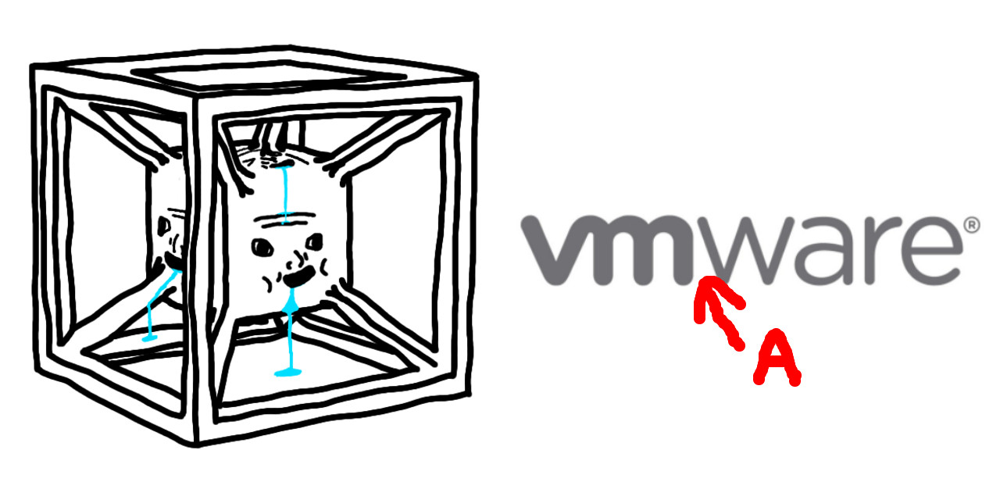
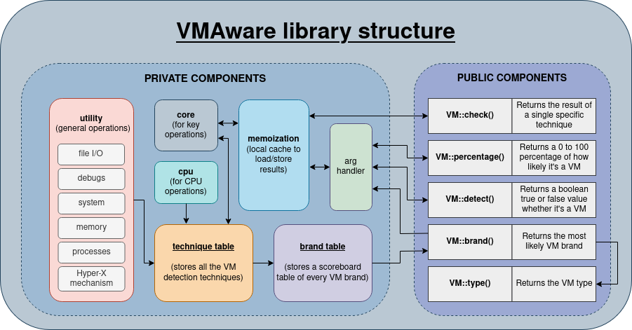
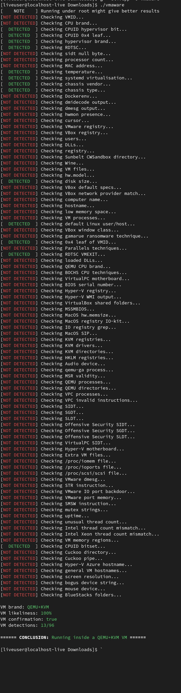
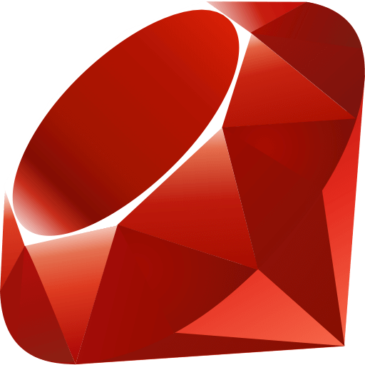
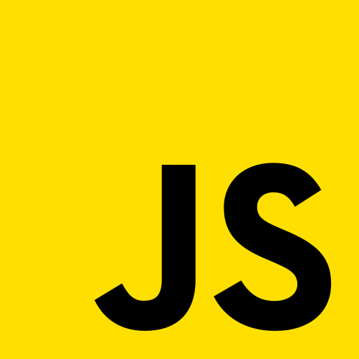
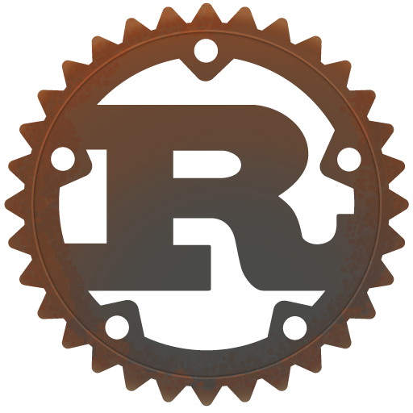

<div align="center">
   
   <br>
   
   
   <br><br>
   <b>VMAware</b> (VM + Aware)는 가상 머신 감지를 위한 크로스 플랫폼 C++ 프레임워크입니다.
   <br><br>
   <a href="README.md">English 🇬🇧</a> | <a href="README_CN.md">中文 🇨🇳</a> | <a href="README_FR.md">Français 🇫🇷</a> | <a href="README_RU.md">Русский 🇷🇺</a>
</div>

- - -

라이브러리 특징:
- 매우 쉬운 사용법
- 크로스 플랫폼 지원 (Windows + MacOS + Linux)
- 다양한 아키텍처 호환 (alpha, amd64, arm64, arm64ec, armel, armhf, hppa, i386, m68k, mips, mipsel, mips64, mips64el, powerpc, ppc64, ppc64el, riscv64, s390x, sh4, sparc64, x32)
- 약 90개의 고유한 VM 감지 기술 탑재 [[목록](https://github.com/NotRequiem/VMAware/blob/main/docs/documentation.md#flag-table)]
- 최첨단 기술로 제작
- VMware, VirtualBox, QEMU, Hyper-V 등을 포함한 약 70개 VM 브랜드 감지 가능 [[목록](https://github.com/NotRequiem/VMAware/blob/main/docs/documentation.md#brand-table)]
- VM 강화(Hardener) 무력화 가능
- 실행할 기술에 대한 세밀한 제어가 가능하여 매우 유연함
- 하이퍼바이저, 에뮬레이터, 컨테이너, 샌드박스 등 다양한 VM 및 준 VM 기술 감지 가능
- 메모이제이션(Memoized) 지원으로 이전 결과를 캐싱하여 재실행 시 성능 향상
- C++11 이상에서 사용 가능
- Rust, JavaScript, Ruby 등 다른 언어로의 포팅 생태계 지원
- 헤더 온리 (Header-only)
- 외부 종속성 없음
- 완전한 MIT 라이선스로 무제한 사용 및 배포 가능

<br>

## 사용 예시 🧪
```cpp
#include "vmaware.hpp"
#include <iostream>

int main() {
    if (VM::detect()) {
        std::cout << "Virtual machine detected!" << "\n";
    } else {
        std::cout << "Running on bare metal" << "\n";
    }

    std::cout << "VM name: " << VM::brand() << "\n";
    std::cout << "VM type: " << VM::type() << "\n";
    std::cout << "VM certainty: " << (int)VM::percentage() << "%" << "\n";
}
```

출력 예시:
```
Virtual machine detected!
VM name: VirtualBox
VM type: Hypervisor (type 2)
VM certainty: 100%
```

<br>

## 라이브러리 구조 ⚙️

<p align="center">

<br>
</p>

<br>

## CLI 도구 🔧
이 프로젝트는 라이브러리의 기능을 최대한 활용할 수 있는 편리한 CLI 도구도 제공합니다. 크로스 플랫폼도 지원합니다.

아래는 Linux 환경에서 보안 강화 수정이 없는 기본 QEMU 시스템의 예시입니다.



<!-- Try it out on [Compiler Explorer](https://godbolt.org/z/4sKa1sqrW)!-->

<br>

## 설치 방법 📥
라이브러리를 설치하려면 최신 [릴리스 섹션](https://github.com/NotRequiem/VMAware/releases/latest)에서 `vmaware.hpp` 파일을 프로젝트로 다운로드하세요. 바이너리 또한 그곳에 있습니다. CMake나 공유 객체 링크가 필요하지 않으며, 말 그대로 매우 간단합니다.

그러나 전체 프로젝트(`<vmaware.hpp>`를 포함한 전역 접근 가능한 헤더 및 CLI 도구)를 원하시는 경우 다음 명령을 따르세요:
```bash
git clone https://github.com/NotRequiem/VMAware 
cd VMAware
```

### LINUX 환경:
```bash
sudo dnf/apt/yum update -y # 배포판에 맞게 변경하세요
mkdir build
cd build
cmake ..
sudo make install
```

### MACOS 환경:
```bash
mkdir build
cd build
cmake ..
sudo make install
```

### WINDOWS 환경:
```bash
cmake -S . -B build/ -G "Visual Studio 16 2019"
```

선택 사항으로, cmake 인수에 `-DCMAKE_BUILD_TYPE=Debug`를 추가하여 디버그 빌드를 생성할 수 있습니다.

<br>

### CMake 설치
```cmake
# edit this
set(DIRECTORY "/path/to/your/directory/")

set(DESTINATION "${DIRECTORY}vmaware.hpp")

if (NOT EXISTS ${DESTINATION})
    message(STATUS "Downloading VMAware")
    set(URL "https://github.com/NotRequiem/VMAware/releases/latest/download/vmaware.hpp")
    file(DOWNLOAD ${URL} ${DESTINATION} SHOW_PROGRESS)
else()
    message(STATUS "VMAware already downloaded, skipping")
endif()
```

모듈 파일 및 함수 버전은 [여기](auxiliary/vmaware_download.cmake)에 있습니다.

<br>

## 문서 및 코드 개요 📒
전체 문서는 [여기](docs/documentation.md)에서 확인하실 수 있습니다. 

함수, 기술, 설정, 예제 등 모든 세부 정보가 제공됩니다. 생각보다 어렵지 않으니 안심하세요 ;)

<br>

## 다른 언어로의 포트 🔀

VMAware는 다양한 언어를 지원합니다. C++가 찾으시는 언어가 아니라면 아래 목록을 참조하세요. 이 모든 프로젝트는 VMAware 개발진에 의해 공식적으로 참조됩니다.

| 언어 | 저장소 | 세부 정보 | 작성자 |
|:---------|:---------------:|:--------:|:------:|
|  Ruby | [링크](https://github.com/NotRequiem/VMAware/tree/main/gem) | VMAware 저장소에 내장된 공식 Ruby 포트입니다. Windows는 지원되지 않습니다. | [Adam Ruman](https://github.com/addam128) |
|  JS | [링크](https://github.com/Kyun-J/node-vm-detect) | 훌륭한 API, 활발히 유지 관리됨. | [Kyun-J](https://github.com/Kyun-J) |
|  Rust | [링크](https://github.com/btwmarcel/vmaware-rs) | 훌륭한 API, 잘 테스트됨, 활발히 유지 관리됨 | [Marcel](https://github.com/btwmarcel) |

> [!WARNING]
> 비공식 포트가 존재하지만, 공식 포트에 비해 테스트되지 않았습니다. 사용에 따른 위험은 사용자 본인이 감수해야 합니다.

<br>

## Q&A ❓

<details>
<summary>어떻게 동작하나요?</summary>
<br>

> 저수준 및 고수준의 안티 VM 기술을 포함하는 포괄적인 목록을 활용하며 점수 시스템에 반영합니다. 각 기술의 점수(0-100)는 오탐을 최대한 최소화하면서 가장 은밀한 VM을 탐지하는 데 초점을 둔 객관적 기준에 따라 부여됩니다. VM을 감지한 모든 기술의 점수는 단일 누적 점수에 합산되며, 임계 점수를 통해 실제로 VM에서 실행 중인지 여부를 판단합니다.

</details>

<details>
<summary>이 라이브러리는 누구를 위한 것이며 어떤 사용 사례가 있나요?</summary>
<br>

> 보안 연구원, VM 엔지니어, 안티치트 개발자 및 프로젝트에 실용적이고 강력한 VM 감지 메커니즘이 필요한 모든 사용자를 위해 설계되었습니다. 이 라이브러리는 VM의 은폐 능력을 테스트하는 악성코드 분석가와 리버스 엔지니어링으로부터 애플리케이션을 보호하려는 상용 소프트웨어 개발자에게 유용합니다. VM이 탐지를 얼마나 잘 숨길 수 있는지 벤치마킹하는 효과적인 도구입니다.
> 
> 또한 소프트웨어는 감지된 환경에 따라 프로그램의 동작을 조정할 수 있습니다. 이는 디버깅 목적으로 유용할 수 있으며, 시스템 관리자는 구성을 다르게 관리할 수 있습니다. 마지막으로 일부 애플리케이션은 무단 배포나 테스트를 방지하기 위해 라이선스 조항으로 VM에서의 사용을 법적으로 제한하고자 할 수 있습니다.

</details>

<details>
<summary>왜 또 다른 VM 감지 프로젝트인가요?</summary>
<br>

> <a href="https://github.com/CheckPointSW/InviZzzible">InviZzzible</a>, <a href="https://github.com/a0rtega/pafish">pafish</a>, <a href="https://github.com/LordNoteworthy/al-khaser">Al-Khaser</a>와 같이 동일한 목표를 가진 프로젝트가 이미 많이 있습니다. 앞서 언급한 프로젝트들과의 차이점은 감지 메커니즘과 상호 작용할 수 있는 프로그래밍 가능한 인터페이스를 제공하지 않으며, Windows 이외의 시스템에 대한 지원이 거의 없다는 점입니다. 또한 이러한 프로젝트의 VM 감지는 실제 시나리오에 실용적으로 적용할 만큼 정교하지 않은 경우가 많습니다. 또 다른 걸림돌은 모두 GPL 프로젝트라는 점이므로, 상용 프로젝트(이러한 기능의 주요 대상)에서 사용하는 것은 불가능합니다. Pafish와 InviZzzible은 수년 동안 방치되었습니다.
> 
> 이러한 프로젝트들이 VMAware에 어느 정도 유용하긴 했지만, 저희는 훨씬 더 뛰어난 프로젝트를 만들고자 했습니다. 우리의 목표는 단순한 CLI 도구를 제공하는 데 그치지 않고, 모든 사용자가 유용하게 활용할 수 있도록 감지 기술을 크로스 플랫폼 및 유연한 방식으로 프로그래밍 가능하게 만드는 것이었습니다. 요약하자면, 이 프레임워크는 모든 시나리오에서 실용적이고 현실적인 사용성에 중점을 둔 VM 감지 프레임워크로, 소프트웨어가 실행 중인 환경에 대한 가장 정확한 결과를 제공하는 것을 목표로 합니다.

</details>

<details>
<summary>오픈 소스로 공개하면 프로젝트에 불리하지 않나요?</summary>
<br>

> VMAware는 완전한 오픈 소스이므로 클로즈드 소스에 비해 우회하려는 사람들의 작업이 더 쉬워집니다. 그러나 저희는 가능한 한 많은 VM 감지 기술을 개방적이고 상호 작용적인 방식으로 보유하는 것이 충분히 가치 있는 절충안이라고 생각합니다. 이는 토론, 협업, 그리고 존재를 숨기려는 안티-안티-VM 프로젝트 및 악성코드 분석 도구와의 경쟁을 통해 라이브러리를 보다 효과적이고 정확하게 강화할 수 있는 소중한 커뮤니티 피드백을 얻을 수 있음을 의미합니다.
> 
> 이 모든 것이 결합되어 클로즈드 소스에 비해 VM 감지 분야의 최첨단 혁신을 훨씬 더 생산적으로 발전시켰습니다. 다시 말해, 난독화를 통한 보안보다 더 나은 품질과 수량, 더 나은 피드백, 더 뛰어난 개방성을 추구합니다. OpenSSH, OpenSSL, Linux 커널 및 기타 보안 기반 소프트웨어 프로젝트가 상대적으로 안전한 이유도 악의적인 의도로 소스 코드를 조사하려는 사람에 비해 개선을 돕는 사람이 더 많기 때문입니다. VMAware는 이러한 철학을 가지고 있으며, 보안에 대해 조금이라도 안다면 "난독화를 통한 보안은 보안이 아니다"라는 문구에 익숙할 것입니다.

</details>

<details>
<summary>VM 하드너(보안 강화 도구)는 이 라이브러리에 얼마나 효과적인가요?</summary>
<br>

> 대중에 알려진 하드너는 효과가 없으며 Windows의 대부분은 무력화되었지만, 그렇다고 라이브러리가 완전히 면역이라는 뜻은 아닙니다. 저희가 인지하지 못할 수도 있는 커스텀 하드너가 이론적인 이점을 가질 수 있지만, 이를 제작하는 것은 훨씬 더 어렵습니다.
> 
> 저희는 오픈 소스 및 클로즈드 소스 프로젝트와 우회 기술을 지속적으로 추적하여 감지합니다. Windows는 VM 감지 우회의 가장 주요한 대상 운영체제이므로, 이 플랫폼에 대한 감지 강화가 주요 초점입니다.
> 
> 현재 Windows에서 감지를 완전히 우회할 수 있는 공개 저장소, 프로젝트 또는 코드베이스는 없습니다. 작동하는 공개 우회법이 발견되면 보통 며칠 내로 수정됩니다. 우리의 군비 경쟁은 주로 VMAware와 안티치트를 모두 우회하기 위해 치터들이 비공개로 유지하는 프라이빗 메서드를 상대로 이루어집니다.

</details>

<details>
<summary>어떻게 개발되나요?</summary>
<br>

> 연구를 통해 현재 VM을 숨기는 데 사용되는 방법을 식별하고 이러한 방법을 감지할 수 있는 일반 감지 기술을 조사합니다.
> 
> 프로덕션에 적합한 코드가 완성되면 이 저장소에 업로드하고 실제 환경에서 실험적인 테스트를 시작합니다. 모든 GitHub 브랜치의 코드는 실험적이며, 최신 릴리스가 안정적인 코드를 나타냅니다.
> 
> 당사의 프로젝트를 사용하는 일부 제품은 수천 대의 시스템에서 당사의 라이브러리를 실행하며, VMAware가 해당 시스템에서 어떻게 작동했는지 보고하는 방식으로 협력하고 있습니다. 이러한 모든 보고서는 오탐이나 일반적인 기타 문제에 대해 수동으로 검토됩니다.
> 
> 기술을 평가하는 동안 해당 기술의 점수는 효율성, 신뢰성 및 다른 감지 기술과의 연계 작동 방식에 따라 동적으로 조정됩니다. 점수를 매기는 데 사용된 기준은 [여기](docs/score_system.md)에서 확인할 수 있습니다.
> 
> GitHub Actions를 사용하여 저장소에 새 커밋이 업로드될 때마다 타겟팅하는 모든 플랫폼에서 컴파일 및 런타임 문제가 발생하는지 자동으로 모니터링합니다.
> 
> 라이브러리에 충분한 변경 사항이 누적되었다고 판단되면 릴리스를 게시하고 변경 사항을 자세히 설명합니다. 릴리스하기 전에 보안 감사를 수행하여 새로 게시된 버전이 안전한지 확인합니다.

</details>

<details>
<summary>악성코드에 이 라이브러리를 사용하는 것은 어떤가요?</summary>
<br>

> 명백한 이유로 이 프로젝트는 악성코드 개발을 권장하지 않습니다. 은폐 목적으로 사용하려 하더라도 애초에 난독화되어 있지 않기 때문에 바이러스 백신에 감지될 가능성이 높습니다.
> 
> 당사는 직접/간접 시스템 호출(syscalling), 인라인 후킹 감지 등 가상화 감지와 관련 없는 악성코드 회피 기술을 사용하여 EDR 탐지를 중단하거나 회피하기 위한 목적으로 라이브러리를 의도적으로 개발하지 않습니다.

</details>

<details>
<summary>커널 모드 구성 요소를 개발할 계획이 있나요?</summary>
<br>

> 아니요. 저희 생각에는 VM 감지를 위한 훌륭한 유저 모드 솔루션이 없기 때문에, 이 수요를 충족하는 데 모든 시간을 할애하고자 합니다. 완전히 유저 모드로 작동하면서도 대부분의 은밀한 가상화 환경을 감지할 수 있습니다. 

</details>

<details>
<summary>스레드 안전(Thread-safe)한가요?</summary>
<br>

> 아니요. 여러 스레드에서 이 라이브러리의 함수를 동시에 호출하지 마세요. 실행하는 데 1초 이상 걸리지 않습니다.

</details>

<details>
<summary>컴파일할 때 링커 오류가 발생합니다</summary>
<br>

> gcc 또는 clang으로 컴파일하는 경우 <code>-lm</code> 및 <code>-lstdc++</code> 플래그를 추가하거나 g++/clang++ 컴파일러를 대신 사용하세요. Linux의 완전히 새로운 VM 환경에서 링커 오류가 발생하는 경우 `sudo apt/dnf/yum update -y`로 시스템을 업데이트하여 필요한 C++ 구성 요소를 설치하세요.

</details>

<br>

## 이슈, 토론, 풀 리퀘스트 및 문의 📬
제안이나 아이디어, 어떤 종류의 기여든 자유롭게 말씀해 주세요! [이슈](https://github.com/NotRequiem/VMAware/issues) 또는 [토론](https://github.com/NotRequiem/VMAware/discussions) 섹션에서 기꺼이 논의하겠습니다. 비공개로 문의하고 싶으시다면 Discord에서 `shenzken`으로 연락해 주세요.

이메일 문의: `vmaware.support@gmail.com`

<br>

## 크레딧, 기여자 및 감사의 말 ✒️

<a href="https://github.com/NotRequiem/VMAware/graphs/contributors">
  
</a>

<br>

- [Requiem](https://github.com/NotRequiem) (Main developer)
- [kernelwernel](https://github.com/kernelwernel) (Former creator and developer of the project)
- [Check Point Research](https://research.checkpoint.com/)
- [Unprotect Project](https://unprotect.it/)
- [Al-Khaser](https://github.com/LordNoteworthy/al-khaser)
- [pafish](https://github.com/a0rtega/pafish)
- [Matteo Malvica](https://www.matteomalvica.com)
- N. Rin, EP_X0FF
- [Peter Ferrie, Symantec](https://github.com/peterferrie)
- [Graham Sutherland, LRQA Nettitude](https://www.nettitude.com/uk/)
- [Alex](https://github.com/greenozon)
- [Marek Knápek](https://github.com/MarekKnapek)
- [Vladyslav Miachkov](https://github.com/fameowner99)
- [(Offensive Security) Danny Quist](chamuco@gmail.com)
- [(Offensive Security) Val Smith](mvalsmith@metasploit.com)
- Tom Liston + Ed Skoudis
- [Tobias Klein](https://www.trapkit.de/index.html)
- [(S21sec) Alfredo Omella](https://www.s21sec.com/)
- [hfiref0x](https://github.com/hfiref0x)
- [Waleedassar](http://waleedassar.blogspot.com)
- [一半人生](https://github.com/TimelifeCzy)
- [Thomas Roccia (fr0gger)](https://github.com/fr0gger)
- [systemd project](https://github.com/systemd/systemd)
- mrjaxser
- [iMonket](https://github.com/PrimeMonket)
- Eric Parker's discord community 
- [ShellCode33](https://github.com/ShellCode33)
- [Georgii Gennadev (D00Movenok)](https://github.com/D00Movenok)
- [utoshu](https://github.com/utoshu)
- [Jyd](https://github.com/jyd519)
- [git-eternal](https://github.com/git-eternal)
- [dmfrpro](https://github.com/dmfrpro)
- [Teselka](https://github.com/Teselka)
- [Kyun-J](https://github.com/Kyun-J)
- [luukjp](https://github.com/luukjp)
- [Randark](https://github.com/Randark-JMT)
- [Scrut1ny](https://github.com/Scrut1ny)
- [Lorenzo Rizzotti (Dreaming-Codes)](https://github.com/Dreaming-Codes)
- [virtfunc](https://github.com/virtfunc)
- [Adam Ruman](https://github.com/addam128)
- [Juan Diego](https://github.com/w451)
- [Wiisus](https://github.com/wiisus)
- [Marcel](https://github.com/MarcelDev)
- [Max Ufer](https://github.com/Manny684)
- [Everdox](https://github.com/everdox)
- [snackapps](https://github.com/snackapps)
- [Bandwidth](https://github.com/bandw1dth)
- [dano20zombie](https://github.com/dano20zombie)
 
<br>

## 법적 고지 📜
귀하는 본 저장소의 사용 방법과 귀하의 사용이 관련 법률, 규정 및 귀하가 상호작용하는 제3자 시스템, 서비스, 계정 또는 데이터의 약관을 준수하는지 확인할 전적인 책임이 있습니다.

본 저장소의 게시나 제3자 제품, 서비스, 이름 또는 상표에 대한 언급은 어떠한 보증도 의미하지 않습니다.

본 저장소에 포함되거나 참조된 제3자 소프트웨어, 모델, 데이터 세트, 바이너리 및 기타 자료는 해당 자체 라이선스 및 약관의 적용을 받습니다. 귀하는 이러한 개별 약관을 검토하고 준수할 책임이 있습니다.


라이선스: MIT